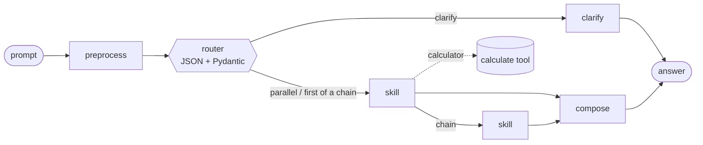

# Skill Agent

[](https://github.com/mhmdjgh/I4TWiNS/actions/workflows/ci.yml)


-76B900)


A multi-skill agent built on LangGraph. You give it a free-form prompt in English or Persian; it works
out which skill (or two) the request needs, runs them and returns one answer.

| Skill | What it does |
|---|---|
| **summarizer** | Summarizes a given text; long texts go through map-reduce |
| **translator** | Persian, English and other languages; numbers, weekdays and leftover words are checked afterwards |
| **calculator** | The model only writes the expression; a safe evaluator, exposed as the LangChain tool `calculate`, computes it |
| **general_chat** | Greetings, small talk and general questions; also the fallback |

Up to two skills run per prompt: in parallel when the tasks are independent, as a chain when the
second needs the first one's output.

| The brief asks for | Where |
|---|---|
| How to run it | [Running it](#running-it) |
| Graph architecture and design decisions | [Architecture](#architecture) |
| Two skills in one prompt, fallback | [Two skills](#two-skills-in-one-prompt), [Fallback](#fallback) |
| Prompt engineering, with a before/after example | [Prompts](#prompts), [prompt notes](docs/prompt-engineering.md) |
| Persian | [Persian](#persian) |
| Model and provider (free, ≤35B) | [Model](#model-and-provider) |
| Evaluation set and accuracy | [Evaluation](#evaluation), [report](evals/report.md) |
| Limitations, assumptions | [Limitations](#limitations-and-what-production-would-need), [Assumptions](#assumptions) |

More detail: [design notes](docs/design-notes.md) (configuration, context handling, adding a skill,
evaluation history) and the [architecture proposal (PDF)](docs/proposal/Skill-Agent-Architecture-Proposal.pdf).

## Running it

You need Python 3.12+, [uv](https://docs.astral.sh/uv/) and a free
[OpenRouter](https://openrouter.ai/keys) key (no credit needed).

```bash
git clone https://github.com/mhmdjgh/I4TWiNS.git && cd I4TWiNS
uv sync
cp .env.example .env        # put your key in LLM_API_KEY
```

`LLM_API_KEY` is the only required setting; the rest are in [`.env.example`](.env.example) and the
[design notes](docs/design-notes.md#configuration). Any OpenAI-compatible endpoint works through
`LLM_BASE_URL` and `LLM_MODEL`.

```bash
uv run skill-agent ask "Translate 'good morning' into Persian, and what is 15% of 3,200?"
uv run skill-agent ask "سلام! حالت چطوره؟" --json    # the whole response as JSON
uv run skill-agent chat                             # interactive (no memory between turns)
uv run skill-agent route "translate this please"    # only the routing decision
uv run skill-agent eval                             # accuracy on evals/dataset.yaml
```

There is also an optional Streamlit dashboard (chat with a "behind the scenes" view of every step,
the graph, and the evaluation results), and a Docker image:

```bash
uv run --extra dashboard streamlit run dashboard/app.py
docker build -t skill-agent . && docker run --rm -p 8501:8501 --env-file .env skill-agent
```

The dashboard calls the agent in-process; there is no web API, as the brief asked.
[deploy/README.md](deploy/README.md) covers hosting it with HTTPS and an optional password.

## Architecture



`preprocess` normalizes Persian text and guesses the language. `router` is the only node that always
calls the model. Each skill has its own node. `clarify` and `compose` are plain code.

Decisions that shaped the code:

- **Skills are plugins.** Each registers itself; the router prompt, the validation and the graph nodes
  are built from the registry, so a new skill is one module and the graph doesn't change.
- **The router reads short cards, not prompts.** A skill's full prompt only loads inside its own node,
  which keeps routing cheap as skills are added.
- **JSON plus Pydantic instead of function calling.** Free models are unreliable at function calling.
  JSON works on any endpoint, and a validation error goes back to the model for one more try.
- **Rules live in code.** Fallback, clarification and low confidence are applied after the model
  answers, so they hold even when the model ignores part of its prompt.
- **Each skill sees only its part.** Skill nodes get a small task through `Send`, never the whole
  state. This turned out to matter for correctness, not just context size.
- **No model call to glue results together.** `compose` formats them itself: cheaper, faster, and it
  can't change a correct answer.
- **One failure doesn't sink the request.** A failing skill shows its error and the other still
  answers; a provider outage gives a short message, not a stack trace.

### Keeping the context window under control

As skills are added and more run per request, every call still has to fit the model's window:

| Growth | Fix |
|---|---|
| More skills | The router reads compact cards; above 8 skills a lexical shortlist (no model call) keeps the 6 most relevant. The prompt stays the same size at 10, 50 or 200 skills. |
| Long messages | The router reads only the beginning and the end. |
| Two skills at once | Parallel steps share one output budget; each step in a chain is capped. |
| Chains | The next step gets only the previous output and the instruction. |
| Texts larger than the window | Map-reduce summaries, chunked translation. |

## Two skills in one prompt

The router decides the shape, because only it can tell whether the tasks depend on each other.

- **Chain**: *"summarize this and translate the summary"*. The translator gets only the summary and
  the instruction, not the original text. The user sees the final output; the intermediate one is in
  the trace.
- **Parallel**: *"translate 'good luck' into Persian, and what is 15% of 3,200?"*. Both run in the same
  step, each on its own part of the message, which the router pins and the code checks against the
  message. Results appear under separate headings.

One shape for everything doesn't work: always chaining slows independent tasks, and always running in
parallel would translate the full text instead of the summary.

## Fallback

| Case | Behaviour |
|---|---|
| Nothing fits (*"write a poem about the sea"*) | `general_chat` answers; refusing would be unhelpful |
| A skill is wanted but the input is missing (*"translate this please"*, «اینو برام خلاصه کن») | A clarifying question in the user's language |
| Low confidence (below 0.4) | Ask instead of guessing; running the wrong skill is worse |
| Router output still invalid after the retry | `general_chat`, with the reason in the trace |
| A skill or the provider fails | The other skill still answers, or a short "model not reachable" message |

## Prompts

The prompts are Markdown files in [`src/skill_agent/prompts/`](src/skill_agent/prompts/). Their full
history (first version, what went wrong with the real model, what changed) is in
[docs/prompt-engineering.md](docs/prompt-engineering.md). What they share:

- Content is fenced (`<request>`, `<text>`), so an "ignore the above" inside a text is treated as text.
- Rules are checkable ("keep names, numbers and dates exactly", not "be accurate").
- Only the router and calculator get examples; free-text skills get rules, since a small model copies
  example wording.
- Where a prompt isn't enough, code checks the output and sends one targeted correction.

**Example: the translator and a wrong weekday.** In the first run, *"The meeting has been moved to
Thursday morning"* came back as «جلسه به صبح **جمعه**…» (Friday). The first prompt was four lines
("translate the user's text, keep the meaning and tone, output only the translation"). The second added
an accuracy section with a weekday list, register and Persian spelling rules; the answer was still
Friday, because a model with 3B active parameters doesn't follow a glossary reliably. The third
version is code: `skills/checks.py` compares numbers and weekdays between source and translation and,
on a mismatch, asks for one precise correction (*"'Thursday' must be translated as «پنجشنبه»"*). In a
later run the model got the weekday wrong again and the check fixed it. The lesson: with a small model,
anything that can be checked mechanically should be.

**The calculator never guesses.** `tools/math_eval.py` parses with `ast` and evaluates only a
whitelist (numbers, operators, `math` functions, `pi`, `e`, `tau`), with exact fractions and limits on
size and depth. There is no `eval`. It accepts `۲۵٪`, `×`, `÷`, `^` and `1,250,000`. The model only
writes expressions and the tool always runs, so a number never comes from the model. Story problems
("sells 35%, then buys 20 more") get a little reasoning for the extraction step, which fixed a sign
error.

## Persian

- Arabic ي/ك become ی/ک and half-spaces are tidied before routing.
- The router has Persian examples, including colloquial ones («چند میشه؟», «اینو برام خلاصه کن»).
- The reply language follows the user's own words, not the text they pasted.
- Prompts ask for standard written Persian; translations are checked for numbers, weekdays
  (پنج‌شنبه in any spelling) and leftover English words.
- The calculator reads Persian digits, `٫` and `٪`, and labels results in Persian.
- The dashboard lays out Persian right to left and keeps math left to right.

## Model and provider

| | Model | Parameters | Provider |
|---|---|---|---|
| Main | `nvidia/nemotron-3.5-lightning:free` | 30B total, ~3B active (MoE) | OpenRouter, free tier |
| Fallback | `google/gemma-4-31b-it:free` | 30.7B | OpenRouter, free tier |

Both are under 35B and free; no credit was bought. Gemma was the first choice for its Persian, but its
free endpoint kept returning `429`, so it became the fallback. Reasoning is off by default: the router
made the same decisions 6× faster, and the free tier allows 50 requests a day.

## Evaluation

[`evals/dataset.yaml`](evals/dataset.yaml): 15 labelled prompts, 7 English and 8 Persian. 7 clear
(chat, calculation, summary, translation both ways), 4 multi-skill (two chains, one parallel, one
greeting plus a square root), 2 ambiguous (a request with no text) and 2 matching no skill (a poem,
a history question about math). A case is correct when the selected skills match exactly, in order for
chains.

| | Result |
|---|---|
| Skill detection | **15/15 (100%)** |
| Clear / multi-skill / ambiguous / no skill | 7/7 · 4/4 · 2/2 · 2/2 |
| Parallel vs chain | 3/3 |
| Precision per skill | 1.00 |

Full run on OpenRouter with `nvidia/nemotron-3.5-lightning:free`; every answer is in
[`evals/report.md`](evals/report.md). It took seven runs to get here (13, 13, 15, 14, 14, 15, 15); the
drops came from reading the answers and checking them more strictly. What each run changed is in the
[design notes](docs/design-notes.md#what-each-evaluation-run-changed).

## Tests and code quality

```bash
uv run ruff check && uv run --extra dashboard mypy src dashboard   # strict
uv run --extra dashboard pytest                  # 212 tests, offline
```

The tests use a scripted chat model, so they need no network. They cover the evaluator (including
injection attempts), routing rules, every path through the graph, the context mechanisms, the checks,
the CLI and the dashboard. GitHub Actions runs them on every push, along with a Docker build. Every
change went through its own branch and [pull request](https://github.com/mhmdjgh/I4TWiNS/pulls?q=is%3Apr),
with Conventional Commits.

```text
src/skill_agent/
├── agent.py, graph.py, state.py   the agent and its StateGraph
├── routing.py                     RoutingDecision, validated against the registry
├── llm.py, config.py              chat client and settings
├── nodes/                         preprocess, router, skill scheduling, clarify, compose
├── skills/                        registry, the four skills, translation checks
├── context/                       token estimates, chunking, budgets, shortlist
├── tools/                         the safe evaluator and the calculate tool
├── text/                          Persian normalization, language names
└── prompts/                       one prompt per skill, plus the router's
dashboard/  evals/  docs/  deploy/  tests/
```

## Limitations and what production would need

- **Free tier**: 50 requests a day and occasional `429`s. Production needs paid or self-hosted
  inference with retries and a circuit breaker.
- **Small evaluation**: 15 cases, answers judged by reading. Production needs hundreds per language,
  an LLM judge plus human review, and a regression gate in CI.
- **Translation checks** catch wrong numbers, weekdays and leftover words, but not a change of meaning,
  and the correction uses the same small model. A stronger model or a back-translation check would help.
- **Story problems are slower** (10 to 30 seconds) because of the reasoning step.
- **Estimated token counts and a lexical shortlist**: fine at this size; production would use the
  model's tokenizer and embedding search over skill cards.
- **Synchronous, numeric-only, no memory**: an async graph with streaming, SymPy for algebra, and
  sessions with authentication would come next, along with proper tracing (OpenTelemetry or LangSmith).

## Assumptions

1. A translation without a target language goes Persian → English, anything else → Persian.
2. For a chain, the user gets the final output; the intermediate step is in the trace.
3. For a greeting plus a task, both "chat + task" and "task alone" count as correct.
4. The agent asks for clarification only when a skill is clearly wanted but can't run, or confidence is
   low; a vague conversational message goes to chat.
5. "Summarize the plot of Hamlet", with no text given, is a chat question, not a summary.
6. Replies follow the language of the user's own words.
7. "Four skills" and "at most two at once" hold by configuration; the design supports more of both.
8. "Parameters" means total parameters: 30B for the main model, about 3B active per token.
